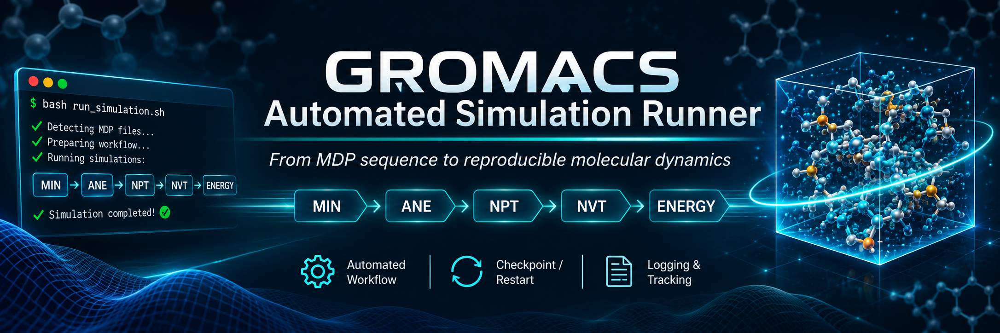

# GROMACS Automated Simulation Runner

<p align="center">
  
</p>

## Descripción General

Script de Bash que automatiza la ejecución de una cola de simulaciones de dinámica molecular con GROMACS. El orden, la carpeta de trabajo y las coordenadas de entrada de cada simulación se definen únicamente con el **nombre de los archivos `.mdp`**. Mientras corre, muestra una **barra de progreso en tiempo real** del paso actual de `mdrun`, indica **en qué posición de la cola** va el proceso y, al terminar cada simulación, reporta el **estado global de la cola**.

## Características Principales

- **Barra de progreso en vivo** del paso de `mdrun` (`paso actual / nsteps`), con porcentaje y posición en la cola (`Sim 2/6`)
- **Estado de la cola** al iniciar y al terminar cada simulación (`Cola: 2/6 procesadas (33%)`), con contador de éxitos y errores
- **Detección automática** de archivos de topología y coordenadas en `Base/`
- **Orden de ejecución por numeración** de los archivos `.mdp`
- **Reanudación segura** de simulaciones interrumpidas (checkpoint `.cpt`): si la reanudación falla, **no** se relanza desde cero ni se sobrescribe el `.tpr`
- **Extracción de energías por nombre de término** (no por índice fijo), compatible con cualquier campo de fuerza o ensamble
- **Salvaguarda de energías**: si `mdrun` ya terminó pero faltan los `.xvg`, solo se re-extraen las energías
- **Contador de advertencias real**: el resumen final cuenta cada `WARNING` registrado
- **Logging completo** con banners y archivo de log con timestamp
- **Barra adaptable** al ancho de la consola, incluso si se redimensiona durante la ejecución
- **Modo no interactivo**: si la salida se redirige (cron, `nohup`, `> archivo`), las barras se desactivan; el estado de la cola igual queda en consola y log

## Estructura de Archivos Requerida

```
project/
├── Base/
│   ├── sistema.top          # Archivo de topología
│   └── sistema.gro          # Archivo de coordenadas inicial
├── MDPs/                    # Archivos de parámetros de simulación
│   ├── 01-150-Base-MIN.mdp
│   ├── 02-150-MIN-ANE.mdp
│   ├── 03-150-ANE-NPT.mdp
│   ├── 04-150-NPT-NVT.mdp
│   ├── 05-160-150_NVT-NVT.mdp
│   └── ...
└── run.sh                   # Script principal
```

## Sistema de Nomenclatura de Archivos MDP

Formato: `numero-carpeta-referencia-simulacion.mdp`

| Campo | Significado | Ejemplo |
|---|---|---|
| `numero` | Orden de ejecución | `01`, `02`, `03`... |
| `carpeta` | Directorio donde se ejecuta la simulación | `150`, `160` |
| `referencia` | Origen de las coordenadas de entrada (`Base` o una simulación previa) | `Base`, `MIN`, `150_NVT` |
| `simulacion` | Nombre/tipo de la simulación | `MIN`, `ANE`, `NPT`, `NVT` |

### Ejemplos

- `01-150-Base-MIN.mdp` → Primera simulación, carpeta `150`, parte de las coordenadas de `Base`, tipo `MIN`
- `05-160-150_NVT-NVT.mdp` → Quinta simulación, carpeta `160`, parte de `150/NVT/NVT.gro`, tipo `NVT`

### Reglas del parseo

- El nombre se divide por `-`: primer campo = número, segundo = carpeta, último = nombre de simulación, y lo que queda en medio = referencia.
- En la referencia, el guion bajo `_` se convierte en `/` (por eso `150_NVT` apunta a `150/NVT`).
- El nombre de la simulación (último campo) determina qué energías se extraen. Admite sufijos, por ejemplo `NPT.Berendsen` o `NPT.Parrinello`, y se trata igual que `NPT`.
- Como `-` es el separador, **no debe usarse dentro de ningún campo**.

## Estructura de Carpetas Generada

```
project/
├── 150/
│   ├── MIN/
│   │   ├── MIN.tpr, MIN.gro, MIN.edr
│   │   ├── potential.xvg
│   │   └── ...
│   ├── ANE/
│   │   ├── ANE.tpr, ANE.gro, ANE.edr
│   │   ├── temp-press.xvg
│   │   └── ...
│   ├── NPT/
│   │   ├── NPT.tpr, NPT.gro, NPT.edr
│   │   ├── temp-press.xvg
│   │   ├── Volumen.xvg
│   │   └── ...
│   └── NVT/
│       └── ...
├── 160/
│   └── NVT/
│       └── ...
└── simulation_log_YYYYMMDD_HHMMSS.log
```

## Progreso y Estado de la Cola

Hay tres elementos, todos con la misma convención: **el porcentaje de la cola cuenta simulaciones ya terminadas** (con éxito o con error), nunca la que está en curso.

### 1. Línea de inicio (solo en terminal)

Se imprime bajo el banner de inicio de cada simulación:

```
Sim 2/6 en curso · 1/6 procesadas (16%)
```

### 2. Barra de pasos de `mdrun` (solo en terminal)

Se repinta cada segundo en una sola línea e incluye la posición en la cola:

```
██████████████░░░░░░░░░░░░░░░░  46%  Paso 4600/10000 · Sim 2/6
```

Al terminar:

```
██████████████████████████████ 100%  ✓ Paso 10000/10000 · Sim 2/6
```

En minimizaciones (`steep`, `cg`, `l-bfgs`), que pueden converger antes de llegar a `nsteps`:

```
██████████████████████████████ 100%  ✓ Terminó en paso 312 (máx. 5000) · Sim 1/6
```

Si el `.mdp` no define `nsteps`, se muestra solo el contador de pasos, sin barra.

### 3. Estado de la cola al terminar cada simulación (consola y log)

Se registra después de **cada** simulación, ya sea ejecutada, saltada por estar completa, reanudada o fallida:

```
[2026-01-15 11:02:40] [PROGRESO] Cola: 2/6 procesadas (33%) · ✓ 2  ✗ 0
...
[2026-01-15 14:30:05] [PROGRESO] Cola: 6/6 procesadas (100%) · ✓ 6  ✗ 0 · cola finalizada
```

Como `✓` cuenta las exitosas y `✗` las fallidas, un `6/6` con errores no se confunde con un éxito total.

### Cómo se calcula el paso actual

1. `nsteps` e `integrator` se leen del `.mdp` (se ignoran comentarios, mayúsculas y la diferencia entre `-` y `_` en las claves).
2. `gmx mdrun -v` se lanza **en segundo plano** y su salida va al archivo de log.
3. Cada segundo se determina el paso actual combinando dos fuentes y tomando la mayor:
   - la salida `-v` de `mdrun` en el log del script (formatos `step N, will finish...`, líneas con prefijo de descomposición de dominios, y `Step= N, Dmax=` en minimización);
   - la tabla `Step Time` del `.log` propio de GROMACS (se actualiza cada `nstlog` pasos).
4. La barra se redibuja ocupando el ancho disponible. Si se redimensiona la ventana (`SIGWINCH`), se borra y redibuja de inmediato.

## Funciones Principales

### 1. Detección de archivos base

```bash
base_dir="Base"
top_file=$(find "$base_dir" -maxdepth 1 -name "*.top" -type f | head -n1)
init_gro_file=$(find "$base_dir" -maxdepth 1 -name "*.gro" -type f | head -n1)
```

Si falta la carpeta `Base`, el `.top` o el `.gro`, el script termina con un error.

### 2. Logging y banners

- `show_simulation_start_banner()` / `show_simulation_end_banner()`: banners globales (el final incluye el tiempo total). Crea `simulation_log_YYYYMMDD_HHMMSS.log`.
- `show_individual_simulation_start()` / `show_individual_simulation_end()`: banners por simulación (tipo, carpeta, estado y tiempo).
- `log_section_separator()`: separadores de sección en el log.
- `log_message()`: logging unificado con niveles `INFO`, `SUCCESS`, `ERROR`, `WARNING` y `PROGRESS`. **Cada `WARNING` incrementa `warning_count`**.
- `log_summary()`: resumen final. El estado es `✓ Éxito` si no hubo errores ni advertencias, `✓ Éxito (advertencias: N)` si solo hubo advertencias, y `✗ Con errores (N)` si hubo errores.

### 3. Progreso

- `render_global_bar()`: línea de inicio de simulación (`Sim N/T en curso · X/T procesadas`).
- `report_queue_status()`: estado de la cola tras cada simulación (consola + log).
- `queue_tag()`: etiqueta `· Sim N/T` que se añade a la barra de pasos.
- `render_step_bar()` / `render_bar()`: barra de pasos con `█` y `░`, ajustada al ancho de la terminal.
- `draw_line()`: repinta la línea actual y gestiona los cambios de tamaño de la consola.
- `get_mdp_value()`: lee valores (`nsteps`, `integrator`) de un `.mdp`.
- `get_current_step_from_log()`: obtiene el paso actual desde el log.
- `run_mdrun_with_progress()`: ejecuta `mdrun` en segundo plano y mantiene la barra viva. Si la salida no es una terminal, delega en `run_mdrun()`.

### 4. Procesamiento de archivos MDP

- `parse_mdp_filename()`: `01-150-Base-MIN.mdp` → `01|150|Base|MIN`
- `find_and_sort_mdps()`: encuentra los `.mdp` en `MDPs/` y los ordena numéricamente. La lista se lee **una sola vez** al inicio para conocer el total de la cola.

### 5. Gestión de rutas

- `get_coordinate_file_path()`: resuelve el `.gro` de entrada (`Base`, otra simulación de la misma carpeta, o de otra carpeta como `150/NVT` desde `160`).
- `get_mdp_file_path()`: resuelve la ruta del `.mdp` dentro de `MDPs/`.

### 6. Ejecución de comandos GROMACS

- `execute_gromacs_command()`: ejecuta un comando registrando encabezado, resultado y código de salida en el log.
- `run_grompp()`: `gmx grompp ... -maxwarn 1`
- `run_mdrun()`: `gmx mdrun -v -pin o -deffnm <nombre>` (modo sin barras)
- `run_energy()`: `gmx energy` con las selecciones por `printf`.

### 7. Extracción de energías por nombre de término

Los índices del menú de `gmx energy` cambian según el campo de fuerza, el termostato/barostato y el ensamble, por lo que **el script no usa números fijos**. En su lugar:

1. `probe_energy_terms()` ejecuta `gmx energy` sobre el `.edr` enviando solo `0`, lo que hace que GROMACS imprima el menú de términos y salga (el `.xvg` de prueba va a un directorio temporal que se borra).
2. Se parsea el menú a una tabla `índice|nombre`.
3. `find_energy_term_index()` busca cada término por **nombre**, sin distinguir mayúsculas y sin la unidad final (`Pressure (bar)` equivale a `Pressure`). La coincidencia es exacta, de modo que `Pressure` no se confunde con `Pres.-DC-(bar)`.
4. `extract_energy_terms()` arma la selección con los índices encontrados y llama a `gmx energy`.

Qué se extrae según el patrón del nombre de la simulación:

| Patrón | Términos | Archivos generados |
|---|---|---|
| `MIN*` | `Potential` | `potential.xvg` |
| `NPT*` | `Temperature`, `Pressure` y `Volume` | `temp-press.xvg`, `Volumen.xvg` |
| cualquier otro (`ANE`, `NVT`...) | `Temperature`, `Pressure` | `temp-press.xvg` |

**Si un término no existe en el `.edr`**, el script **no adivina un índice**: registra una advertencia con los términos faltantes y extrae solo los disponibles. Si no hay ninguno disponible, no genera ese `.xvg` y lo registra también como advertencia.

> Para comprobar qué términos ve el script en tu sistema: `echo 0 | gmx energy -f NPT.edr`. Las líneas del menú del tipo `11  Potential` son las que se parsean.

### 8. Verificación y reanudación

**`is_simulation_complete()`** considera una simulación completa si existen `.tpr`, `.gro` y los `.xvg` esperados según su patrón.

**`check_and_continue_simulation()`** devuelve tres códigos distintos:

| Código | Significado |
|---|---|
| `0` | Lista: ya estaba completa, solo se re-extrajeron energías, o se reanudó con éxito |
| `1` | No hay nada que reanudar: se ejecuta desde el principio |
| `2` | Intentó reanudar/completar y **falló** |

Comportamiento por situación:

| Situación | Acción |
|---|---|
| Simulación completa | Se salta |
| Existen `.gro` y `.edr` pero faltan `.xvg` | Solo se re-extraen las energías (no se repite `mdrun`) |
| Existe `.tpr` pero no terminó, con `.cpt` | `mdrun -cpi` continúa desde el checkpoint (con barra de progreso) |
| Existe `.tpr` pero no terminó, sin `.cpt` | Advertencia y reinicio de `mdrun` |
| La reanudación falla (código `2`) | Se cuenta como error y **no se relanza desde `grompp`**: el `.tpr` y el `.cpt` se conservan |

Si una reanudación falla y quieres empezar esa simulación de cero, borra manualmente su carpeta (por ejemplo `rm -r 150/NPT`) y vuelve a ejecutar `./run.sh`.

### 9. Simulación individual

`run_simulation_from_mdp()` orquesta cada simulación nueva: banner → creación de directorio → verificación de `.gro`, `.top` y `.mdp` → `grompp` → `mdrun` con barra → extracción de energías → banner final con el tiempo.

## Flujo de Ejecución

1. **Inicialización**: verifica `Base/`, inicia el log, lista y ordena los `.mdp` y calcula el total de la cola.
2. **Bucle por orden numérico**: para cada `.mdp` calcula su posición en la cola y decide si saltar, reanudar o ejecutar.
3. **Cada simulación**: `grompp` → `mdrun` (barra de pasos + posición en la cola) → extracción de energías por nombre.
4. **Tras cada simulación**: se registra el estado de la cola (`Cola: N/T procesadas`).
5. **Finalización**: resumen con simulaciones procesadas, errores y advertencias, y banner final con el tiempo total.

## Ejemplo de Ejecución

### Archivos MDP

1. `01-150-Base-MIN.mdp` – Minimización desde coordenadas base
2. `02-150-MIN-ANE.mdp` – Annealing desde la minimización
3. `03-150-ANE-NPT.mdp` – Equilibrio NPT desde el annealing
4. `04-150-NPT-NVT.mdp` – Producción NVT desde NPT
5. `05-160-150_NVT-NVT.mdp` – Producción en `160` desde `150/NVT`

### Ejecución

```bash
chmod +x run.sh
./run.sh
```

### Salida esperada (durante la 2.ª simulación)

```
[2026-01-15 10:44:50] [PROGRESO] Cola: 1/5 procesadas (20%) · ✓ 1  ✗ 0
[2026-01-15 10:44:50] [PROGRESO] Procesando [02] (2/5): 150 - ANE (Referencia: MIN)

╔════════════════════════════════════════════╗
          INICIO - ANNEALING
╠════════════════════════════════════════════╣
  Fecha: 2026-01-15 10:44:50
  Carpeta: 150
  Simulación: ANE
╚════════════════════════════════════════════╝
Sim 2/5 en curso · 1/5 procesadas (20%)
██████████████░░░░░░░░░░░░░░░░  46%  Paso 4600/10000 · Sim 2/5
```

## Archivos de Log

`simulation_log_YYYYMMDD_HHMMSS.log` contiene banners, comandos ejecutados, la salida completa de GROMACS (incluida la de `mdrun -v`), tiempos, errores, advertencias, el estado de la cola tras cada simulación y el resumen final.

```bash
tail -f simulation_log_20260115_104500.log
```

## Dependencias

- **GROMACS** (`gmx`) instalado y en el `PATH`
- **Bash 4.3** o superior (`mapfile` e índices negativos de arrays)
- `awk`, `find`, `sed`, `tput`, `mktemp` (disponibles por defecto en WSL2/Ubuntu)

## Uso

```bash
chmod +x run.sh
./run.sh

# Ejecución desatendida (sin barras; el avance queda en el log)
nohup ./run.sh > salida.txt 2>&1 &
tail -f simulation_log_*.log
```

## Cambios respecto a la versión anterior

- **Cola global**: el porcentaje ahora se reporta al terminar cada simulación (`Cola: N/T procesadas`), con contador de éxitos y errores. La barra de pasos incluye `· Sim N/T`, y la línea de inicio aclara que cuenta simulaciones ya procesadas.
- **Advertencias**: `warning_count` se incrementa en cada `log_message "WARNING"`, por lo que el resumen final ya no marca siempre 0.
- **Reanudación**: si falla, ya no se relanza desde `grompp`; se cuenta como error y se conservan `.tpr` y `.cpt`.
- **Energías**: los términos se buscan por nombre en el `.edr` en lugar de usar índices fijos (10, 15, 17, 22).
- **Resumen**: el banner final indica `✓ Éxito (advertencias: N)` cuando hubo advertencias sin errores.

Este sistema permite organizar y ejecutar protocolos de simulación complejos de forma reproducible y automatizada, con seguimiento visual del avance y verificación del estado de cada paso.
